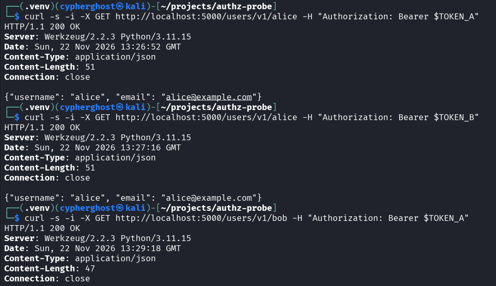
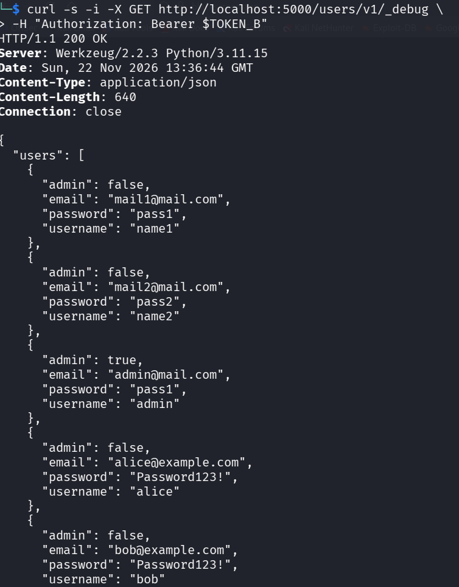
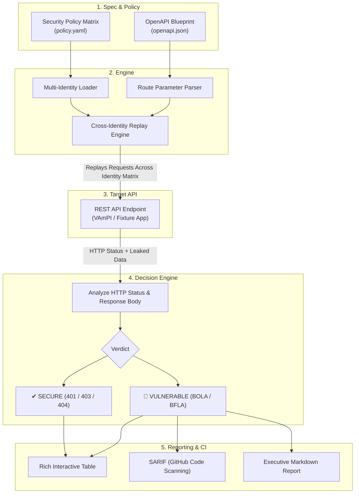
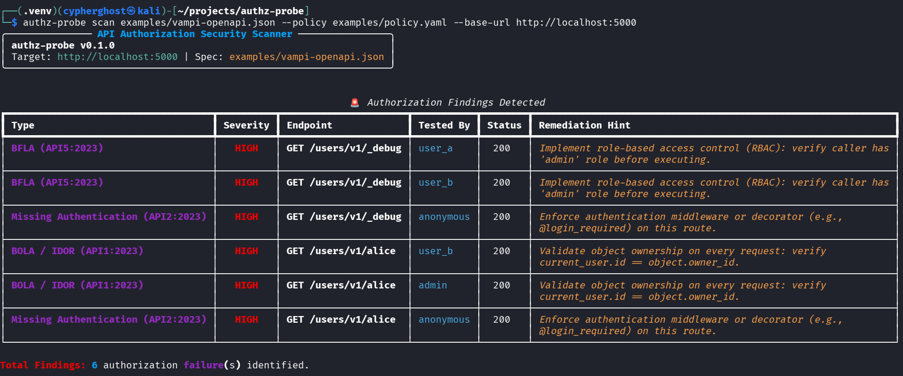
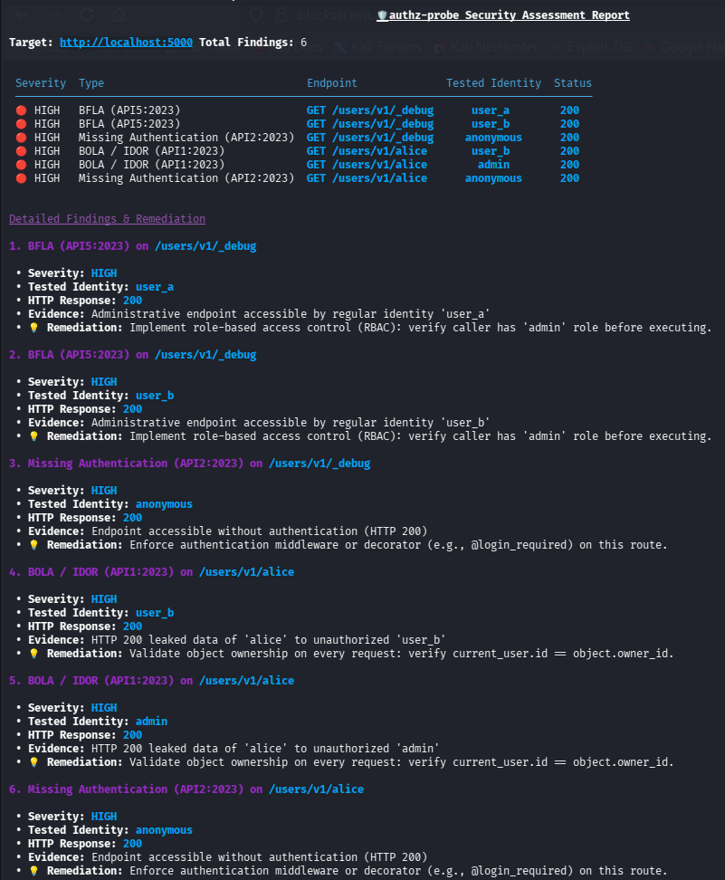
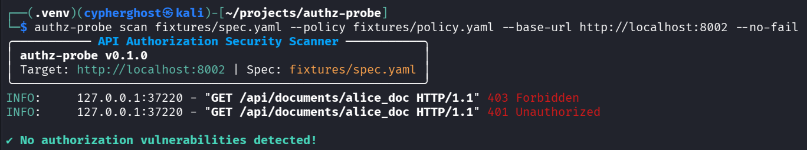
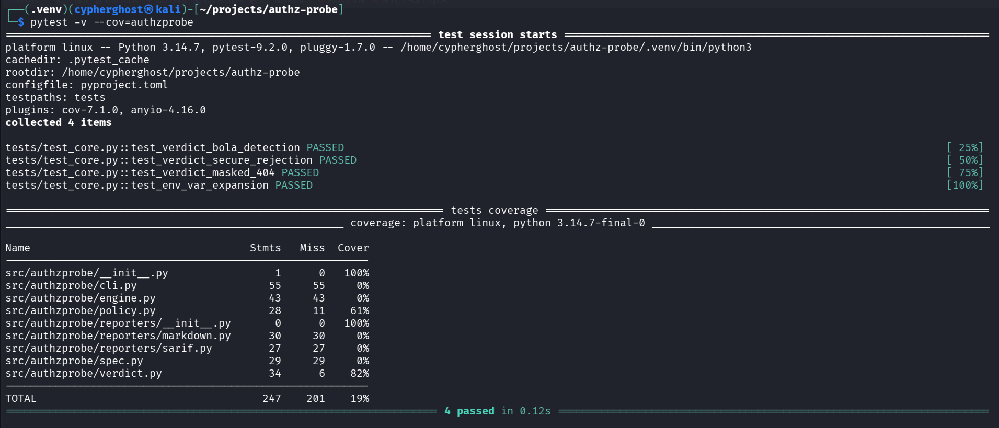
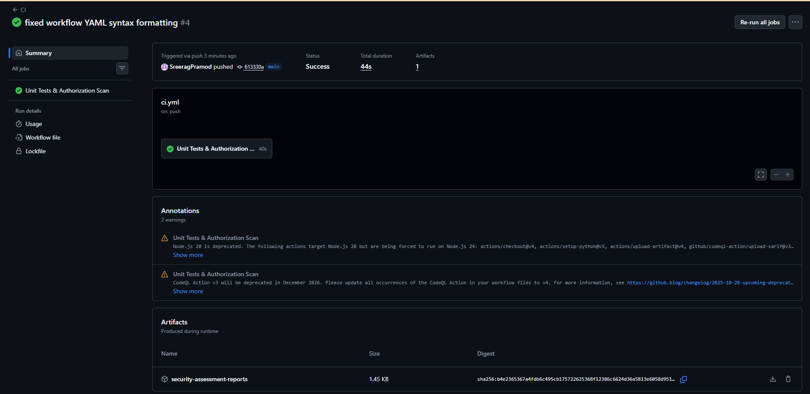

# 🛡️ authz-probe

[](https://github.com/SreeragPramod/authz-probe/actions/workflows/ci.yml)
[](https://www.python.org/downloads/)
[](https://opensource.org/licenses/MIT)
[](https://owasp.org/API-Security/)

> **Automated API Authorization Security Testing Engine.** Detects Broken Object Level Authorization (BOLA/IDOR), Broken Function Level Authorization (BFLA), and Missing Authentication before code ships to production.

---

## 💡 What is this project? (The Plain-English Summary for Recruiters)

Imagine you check into a hotel and get an electronic room key for **Room 101**. 
* If you walk up to **Room 102**, swipe your key, and the door opens — that is **BOLA** (Broken Object Level Authorization).
* The hotel's lock verified that you are a registered guest (Authentication), but **failed to check if Room 102 actually belongs to you** (Authorization).

In the software world, this exact bug allows Customer A to view Customer B’s invoices, medical records, or passwords simply by changing a number in the website address. 

According to the international security organization OWASP, **BOLA is the #1 most dangerous vulnerability in modern APIs**. Traditional automated security scanners almost always miss it because a legitimate response looks "successful" to a computer.

**`authz-probe` solves this problem:** It automatically simulates multiple users simultaneously, tests whether User B can access User A's private data, verifies if the victim's data actually leaked, and blocks vulnerable code in automated CI/CD pipelines before it ever reaches customers.

---

## 🎯 The Technical Problem & Evidence

Most automated tools (like OWASP ZAP or Burp Suite's basic scanners) only scan with a single user account. They don't know who owns what object.

Here is proof of the vulnerability reproduced manually on a vulnerable API target:


*Evidence: User B (`bob`) successfully uses their own login token to steal User A's (`alice`) private profile information (HTTP 200 OK).*

And here is evidence of a standard user accessing administrative debug functions (BFLA):

*Evidence: A regular account accessing `/users/v1/_debug` and dumping system passwords.*

---

## 🏗️ How authz-probe Works (Architecture)



---

## 🔬 Scientific Proof: The Before-and-After Verification

To eliminate false alarms, `authz-probe` was tested against two versions of an API:
1. **Vulnerable Version (Port 8001):** Missing server-side ownership checks.
2. **Fixed Version (Port 8002):** Implements strict server-side ownership checks (`if document.owner != current_user: return 403`).

### 1. Running against the Broken/Vulnerable API (Catches the Flaw):
`authz-probe` detects that User B can read Alice's documents and flags it **`HIGH VULNERABLE`**:


### 2. Running against the Secured/Fixed API (Zero False Positives):
When the developer adds proper authorization checks, `authz-probe` confirms all access is denied (`403 Forbidden`) and reports **`0 findings` (Clean)**:


---

## 📊 Executive Reporting with Remediation Guidance

Security findings shouldn't just complain — they should guide developers on how to fix the code. `authz-probe` automatically redacts sensitive tokens and produces executive Markdown reports:



---

## ⚙️ Enterprise Engineering & CI/CD Automation

This project is built to production software engineering standards:

### 1. Automated Unit Tests with Pytest
Full test suite verifying verdict logic, environment variable expansion, and status code handling:


### 2. Automated GitHub Actions Pipeline
Every commit automatically triggers a 44-second CI/CD pipeline that provisions an environment, runs all tests, boots a test API, and generates security reports:


---

## ⚖️ How authz-probe Compares to Existing Tools

| Capability | Burp Suite Autorize | Burp AuthMatrix | OWASP ZAP | Schemathesis | **authz-probe** |
|:---|:---:|:---:|:---:|:---:|:---:|
| **Spec-Driven (OpenAPI)** | ❌ No | ❌ No | ⚠️ Partial | ✅ Yes | **✅ Yes** |
| **Headless CI/CD Native** | ❌ No (GUI Proxy) | ❌ No (GUI Proxy) | ✅ Yes | ✅ Yes | **✅ Yes (44s CI run)** |
| **Multi-Identity BOLA Matrix** | ✅ Yes | ✅ Yes | ❌ No | ❌ No | **✅ Yes** |
| **Native SARIF Output** | ❌ No | ❌ No | ⚠️ Plugin | ❌ No | **✅ Yes (OASIS 2.1.0)** |
| **Requires Manual Browsing**| Yes (Proxy driven) | Yes (Manual grid) | No | No | **No (Fully automated)** |

* **Autorize vs. authz-probe:** Autorize is built for a human pentester clicking in a browser. `authz-probe` is built for automated DevSecOps pipelines.
* **OWASP ZAP vs. authz-probe:** ZAP scans with a single session and misses BOLA because it doesn't model data ownership. `authz-probe` models cross-user permissions.

---

## 🚀 Quick Start (Try It Yourself)

### 1. Installation
```bash
git clone https://github.com/SreeragPramod/authz-probe.git
cd authz-probe

# Create and activate virtual environment
python3 -m venv .venv
source .venv/bin/activate

# Install dependencies
pip install -e ".[dev]"
```

### 2. Run Tests
```bash
pytest -v --cov=authzprobe
```

### 3. Run a Scan
```bash
authz-probe scan examples/vampi-openapi.json \
  --policy examples/policy.yaml \
  --base-url http://localhost:5000 \
  --output-md docs/report.md \
  --output-sarif docs/report.sarif \
  --no-fail
```

---

## ⚠️ Documented Limitations

- **Stateful Multi-Step Workflows:** Tests direct parameterized routes; complex multi-stage checkout flows require pre-seeded state.
- **Protocols:** Designed for REST APIs documented via OpenAPI v3 (GraphQL and WebSockets are out of scope).
- **Environment:** Intended for pre-production/staging environments without CAPTCHA or anti-bot rate-limiting.

---

## 📄 License & Responsible Use

This project is licensed under the [MIT License](LICENSE).

**Responsible Testing Notice:** This tool is strictly intended for testing applications you own or deliberately vulnerable learning labs (e.g., VAmPI, crAPI). Never target external systems without explicit written permission.
