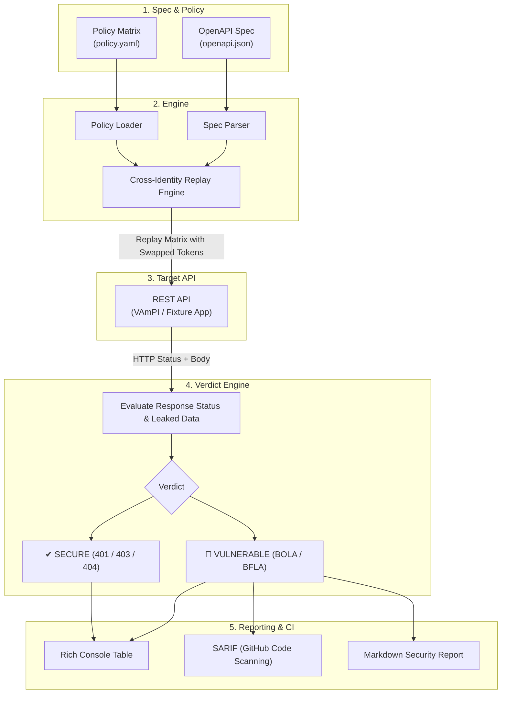

# 🛡️ authz-probe

[](https://github.com/SreeragPramod/authz-probe/actions/workflows/ci.yml)
[](https://www.python.org/downloads/)
[](https://opensource.org/licenses/MIT)
[](https://owasp.org/API-Security/)

> **Spec-driven API authorization security testing engine.** Automatically detects Broken Object Level Authorization (BOLA/IDOR), Broken Function Level Authorization (BFLA), and Missing Authentication from OpenAPI specifications.

---

## 🎯 The Problem

Broken Object Level Authorization (BOLA) is the **#1 vulnerability in the OWASP API Security Top 10 (API1:2023)**. 

Traditional DAST scanners (like OWASP ZAP or Burp Active Scanner) struggle to detect BOLA because they scan with a single session and cannot determine business logic ownership: to a scanner, a `200 OK` response returning another user's invoice looks like a normal successful request.

**authz-probe solves this by modeling ownership:**
- **Spec-Driven:** Parses OpenAPI specifications to identify parameterized object routes (e.g., `/api/users/{id}`).
- **Policy-Aware:** Ingests a multi-identity access policy (`policy.yaml`) defining user roles and credentials.
- **Cross-Identity Replay:** Replays requests across user identities and evaluates whether response bodies leak victim data.
- **DevSecOps Native:** Emits **SARIF 2.1.0** reports directly to **GitHub Code Scanning** and returns non-zero exit codes to enforce automated security gates in CI/CD pipelines.

---

## 🏗️ Architecture & Pipeline



---

## 🚀 Quick Start

### 1. Installation
Clone the repository and install in editable mode:

```bash
git clone https://github.com/SreeragPramod/authz-probe.git
cd authz-probe

# Create and activate virtual environment
python3 -m venv .venv
source .venv/bin/activate

# Install with development dependencies
pip install -e ".[dev]"
```

### 2. Run Tests
```bash
pytest -v --cov=authzprobe
```

### 3. Run a Scan Against VAmPI
```bash
# Export tokens for your test users
export TOKEN_A="<alice_jwt_token>"
export TOKEN_B="<bob_jwt_token>"

# Execute scan
authz-probe scan examples/vampi-openapi.json \
  --policy examples/policy.yaml \
  --base-url http://localhost:5000 \
  --output-md report.md \
  --output-sarif report.sarif
```

---

## 🔬 Verified Before & After Demonstration

To prove detection accuracy without false positives, `authz-probe` includes both a deliberately vulnerable API fixture and a secured fixture:

| Fixture Target | Port | Ownership Enforcement | authz-probe Result |
|---|:---:|:---:|:---:|
| `fixtures/vulnerable_app.py` | 8001 | ❌ Missing (`return DOCUMENTS[doc_id]`) | **🚨 VULNERABLE (BOLA Detected)** |
| `fixtures/fixed_app.py` | 8002 | ✅ Enforced (`doc["owner"] == current_user`) | **✔ 0 Findings (Clean)** |

---

## ⚖️ How authz-probe Compares to Existing Tools

| Capability | Burp Autorize | Burp AuthMatrix | OWASP ZAP | Schemathesis | **authz-probe** |
|:---|:---:|:---:|:---:|:---:|:---:|
| **Spec-Driven (OpenAPI)** | ❌ No | ❌ No | ⚠️ Partial | ✅ Yes | **✅ Yes** |
| **Headless CI/CD Native** | ❌ No (GUI Proxy) | ❌ No (GUI Proxy) | ✅ Yes | ✅ Yes | **✅ Yes (44s CI run)** |
| **Multi-Identity BOLA Matrix** | ✅ Yes | ✅ Yes | ❌ No | ❌ No | **✅ Yes** |
| **Native SARIF Output** | ❌ No | ❌ No | ⚠️ Plugin | ❌ No | **✅ Yes (OASIS 2.1.0)** |
| **Requires Manual Browsing**| Yes (Proxy driven) | Yes (Manual grid) | No | No | **No (Fully automated)** |

---

## ⚠️ Documented Limitations

- **Stateful Multi-Step Workflows:** Current version tests individual parameterized routes; complex multi-step checkout sequences require pre-seeded state.
- **Protocols:** Designed for RESTful APIs documented with OpenAPI v3 (GraphQL and WebSockets are out of scope).
- **Environment:** Designed for non-production/staging environments without CAPTCHA or anti-bot rate limiting.

---

## 📄 License & Responsible Use

This project is licensed under the [MIT License](LICENSE).

**Responsible Security Testing:** This tool is designed for authorized testing of systems you own or deliberately vulnerable learning environments (VAmPI, crAPI). Never target external systems without explicit written consent.
